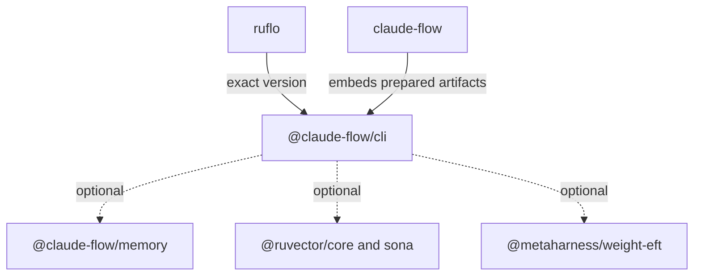

# Packages that work together

The ecosystem is a set of cooperating layers, not a requirement to install every package. An application should pull in the capabilities it actually uses.

| Layer | Example | Relationship |
| --- | --- | --- |
| Entry point | `ruflo` | Pins the matching scoped CLI version |
| Orchestration | `@claude-flow/cli` | Coordinates memory, neural services, MCP and optional extensions |
| Persistent context | `@claude-flow/memory` | Optional CLI capability with an explicit version |
| Native vector operations | `@ruvector/core`, `@ruvector/sona`, `ruvector` | Optional acceleration and learning integrations with fallback behavior |
| Evaluation and improvement | MetaHarness packages | Optional integrations activated through existing adapters |



Solid arrows describe the entry points; dotted arrows describe capabilities that can be absent. The umbrella declares its own runtime dependencies because embedding CLI files does not transfer npm dependency ownership.

[Captured registry relationships](../../data/npm-dependencies.latest.json) distinguish required dependencies, optional dependencies and peers. Every node has a captured version and registry URL. The graph includes the full download inventory plus packages whose download counts were unavailable; missing downloads do not mean a missing npm package.

```bash
node scripts/collect-ecosystem-dependencies.mjs \
  --input data/npm-downloads.latest.json \
  --output data/npm-dependencies.latest.json \
  --require-complete
```

This reads public manifests only. It never needs an npm token, runs install scripts or executes the packages. A nonzero result retains the snapshot for inspection: exit 1 means a package name declaration cycle, exit 2 means required metadata is incomplete. Version ranges are preserved, not resolved into an installation tree.

The graph's `reverseImpact` identifies consumers affected by a required dependency. `capabilityReverseImpact` also includes optional and peer relationships. `graphPlanAvailable` only describes whether the captured name graph has complete metadata and can be ordered; it is not a release approval, security audit or compatibility certificate.

For example, the latest manifests of `strange-loops` and `sublinear-time-solver` point at each other's package names, but their ranges target different major versions. That is useful architecture evidence, not proof of an npm installation cycle.

[Design, release gates and acceptance checks](../../v3/docs/adr/ADR-492-ecosystem-dependency-contracts.md).
