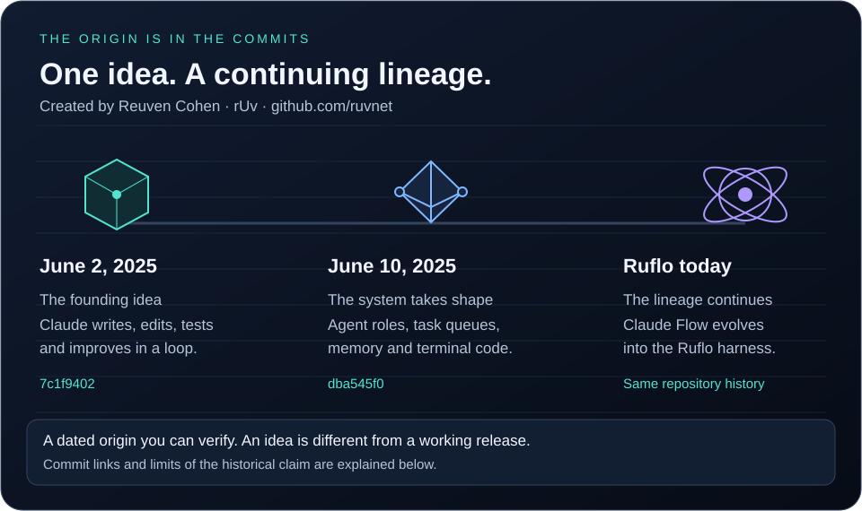
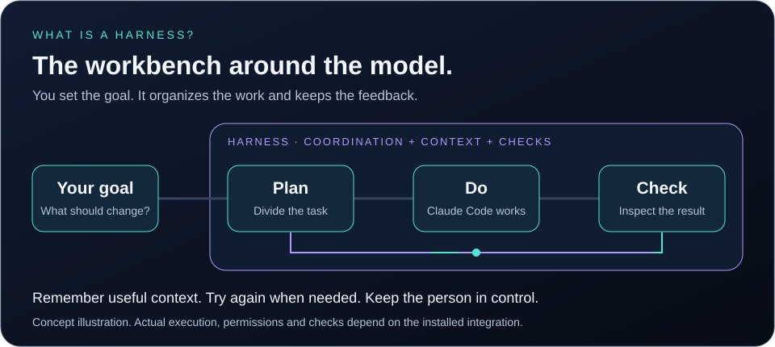

# Claude Flow to Ruflo: the origin, in the commits

**Created by [Reuven Cohen, known as rUv](https://github.com/ruvnet). First repository commit: June 2, 2025.** [rUv's website](https://ruv.io) · [Back to Ruflo](../README.md)



## The idea in everyday language

Claude Code can work on code. An agent harness supplies a workbench around it: a way to divide a goal into tasks, carry useful context between steps, coordinate work and inspect the result before trying again.

Think of a small software team. Someone plans, someone implements, someone checks. The harness organizes those steps; the model and its tools do the actual work. A plan or an agent record alone does not mean work has happened.



*Concept illustration, not a recording of a live run. Available behavior depends on the installed version, client, configuration and permissions.*

## The dated record

The dates below describe specific evidence, rather than assigning every modern Ruflo feature to its first day. Commit timestamps are normalized to UTC; the initial commit is also shown in Toronto time.

| Date | Evidence you can open | What it establishes |
| --- | --- | --- |
| February 24, 2025 | [Anthropic introduces Claude Code](https://www.anthropic.com/news/claude-3-7-sonnet) | Claude Code is introduced in a limited research preview. This is platform context, not a Ruflo milestone. |
| June 2, 2025, 21:24:20 UTC, 17:24:20 EDT | [Root commit `7c1f9402`](https://github.com/ruvnet/ruflo/commit/7c1f9402d70e7af56c01a879073cbac92564dc4e) · [Original README](https://github.com/ruvnet/ruflo/blob/7c1f9402d70e7af56c01a879073cbac92564dc4e/README.md) | rUv starts `claude-code-flow`. Its README describes code orchestration and recursive cycles of writing, editing, testing and optimization. The tree contains a README and license, not a working implementation. |
| June 10, 2025, 03:48:41 UTC | [Commit `dba545f0`](https://github.com/ruvnet/ruflo/commit/dba545f012ea92a2375a26332bbf3797495e93c9) · [Source snapshot](https://github.com/ruvnet/ruflo/tree/dba545f012ea92a2375a26332bbf3797495e93c9/src) | The repository contains orchestration, task scheduling, memory, terminal management, CLI and MCP modules. This is source evidence, not a retrospective runtime or coverage certification. |
| Continuing lineage | [Current repository history](https://github.com/ruvnet/ruflo/commits/main/) | The project now called Ruflo retains its Claude Flow history. Current capabilities should be checked against current documentation and tests. |

## What was already present in the early design?

| Idea | Plain language | Pinned historical evidence |
| --- | --- | --- |
| Recursive work cycles | Write something, inspect it and improve it in another pass. | [June 2 README](https://github.com/ruvnet/ruflo/blob/7c1f9402d70e7af56c01a879073cbac92564dc4e/README.md) |
| Agent roles | Give different kinds of work different responsibilities. | [June 10 agent command source](https://github.com/ruvnet/ruflo/blob/dba545f012ea92a2375a26332bbf3797495e93c9/src/cli/commands/agent.ts) |
| Tasks, context and tool access | Organize the queue, retain useful information and expose tools. | [June 10 README and architecture](https://github.com/ruvnet/ruflo/blob/dba545f012ea92a2375a26332bbf3797495e93c9/README.md) |
| Managed terminal sessions | Give work a terminal session and manage its lifecycle. | [June 10 terminal manager](https://github.com/ruvnet/ruflo/blob/dba545f012ea92a2375a26332bbf3797495e93c9/src/terminal/manager.ts) |

**Read the code as well as the descriptions.** For example, the June 10 `agent spawn` CLI creates and prints an agent profile and says a running instance is required. That command alone is not evidence that it launched a working Claude Code agent. Historical README claims about coverage or completeness are not independently verified by this timeline.

## Prior art and the scope of the claim

The strongest supported statement is: **Ruflo's Claude Flow lineage begins with rUv's June 2, 2025 commit describing recursive agent orchestration.**

That is different from proving the first public release, the first working implementation, or being the first Claude Code harness in the world. Git author and committer dates can be set by contributors. They identify the recorded history, not independently witnessed publication times.

There is earlier public ecosystem context. [Claude Squad issue 56, opened April 6, 2025](https://github.com/smtg-ai/claude-squad/issues/56), discusses launching Claude Code across repositories, and a collaborator describes using it in multiple repositories that day. This predates Ruflo's root commit and makes an unrestricted claim to the first Claude Code coordination tool untenable. It does not establish that the two projects had identical architectures or capabilities.

Here, **prior art** means dated technical context and disclosed ideas. It is not a patent novelty opinion, a claim of copying, or an exhaustive survey. A narrower priority claim would need an explicit feature definition, a comparable working source snapshot and a broader search of earlier systems.

## Verify the origin yourself

In a full clone of this repository:

```bash
# Show every root reachable from the current branch.
git rev-list --max-parents=0 HEAD

# Inspect the recorded author, committer and timestamps.
git show --no-patch --format=fuller 7c1f9402d70e7af56c01a879073cbac92564dc4e

# See exactly what existed on the first day.
git ls-tree --name-only 7c1f9402d70e7af56c01a879073cbac92564dc4e
git show 7c1f9402d70e7af56c01a879073cbac92564dc4e:README.md

# Compare that with the early orchestration source.
git show --stat dba545f012ea92a2375a26332bbf3797495e93c9
git show dba545f012ea92a2375a26332bbf3797495e93c9:src/cli/commands/agent.ts
```

**Acceptance check:** the root is `7c1f9402d70e7af56c01a879073cbac92564dc4e`, its recorded date is June 2, 2025, and its tree has `LICENSE` and `README.md`. Open the pinned source links to distinguish the original idea from later implementation.

The SVGs use local assets, accessible titles and descriptions, readable static frames and a reduced motion setting. The README supplies clickable wrappers because GitHub displays SVG images without interactive links inside them. No JavaScript or external fonts are required.
